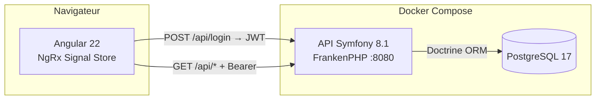

# Supervision logistique — démo Symfony & Angular

Application de démonstration : supervision d'un entrepôt fictif (équipements, missions de
transport, alarmes). Toutes les données sont inventées ; aucun code ni nom ne provient d'une
mission client.

| Partie | Stack |
| --- | --- |
| `api/` | Symfony 8.1, PHP 8.4, contrôleurs REST, Doctrine ORM, PostgreSQL 17, JWT (LexikJWTAuthenticationBundle) |
| `front/` | Angular 22 (zoneless, composants standalone), NgRx Signal Store, Vitest |
| Outillage | Docker Compose (FrankenPHP + PostgreSQL), GitLab CI |

## Avancement

- [x] **Jalon 1** — squelette, authentification JWT, rôles, CI
- [ ] **Jalon 2** — métier de bout en bout : équipements, missions de transport, alarmes
- [ ] **Jalon 3** — temps réel (Mercure) et vue D3 synchronisée avec les tableaux

## Architecture



En développement, `ng serve` relaie `/api` vers `http://localhost:8080` (`front/proxy.conf.json`) :
pas de CORS à configurer.

### Authentification et rôles

1. `POST /api/login` (`{ "email", "password" }`) renvoie `{ "token" }`.
2. Le front appelle `GET /api/me` avec le jeton et stocke le profil dans `AuthStore`.
3. L'intercepteur ajoute `Authorization: Bearer …` à chaque appel `/api/*` et ferme la session
   sur un 401.

Les rôles sont hiérarchiques : `ROLE_OPERATOR` < `ROLE_SUPERVISOR` < `ROLE_ADMIN`. L'API renvoie
les rôles **effectifs** (hiérarchie résolue), le front n'a donc aucune règle à dupliquer. L'API
reste l'autorité : les gardes Angular ne protègent que l'affichage.

| Route | Accès |
| --- | --- |
| `GET /api/health` | public |
| `POST /api/login` | public |
| `GET /api/me` | utilisateur connecté |
| `GET /api/users` | `ROLE_ADMIN` |

### Choix techniques

- **Contrôleurs REST maison plutôt qu'API Platform** : le contrat HTTP et les DTO sont écrits à
  la main, ce qui rend chaque décision visible.
- **DTO en sortie** (`App\Dto\UserView`) : l'entité n'est jamais sérialisée, le mot de passe ne
  peut pas fuiter.
- **Jeton dans `sessionStorage`** : simple et suffisant pour une démo. En production, un cookie
  `httpOnly` est préférable.
- **Signal Store** : l'état de session (jeton, profil, statut, erreur) vit dans un seul store ;
  les gardes et l'intercepteur le lisent de façon synchrone.

## Démarrer

Prérequis : Docker, Node.js 22.22+ et `make`.

```bash
make init    # image, dépendances, clés JWT, migration, comptes de démo, npm ci
make front   # http://localhost:4200
```

Au premier `make init`, Symfony Flex génère les fichiers du squelette (`bin/console`,
`public/index.php`, `src/Kernel.php`, `config/…`, `.env`, `symfony.lock`) et Doctrine génère la
première migration. **Ces fichiers sont à committer** avec `composer.lock`.

Comptes de démonstration (mot de passe `demo`) :

| E-mail | Rôle |
| --- | --- |
| `operateur@demo.test` | opérateur |
| `superviseur@demo.test` | superviseur |
| `admin@demo.test` | administrateur |

## Commandes

```bash
make help        # liste complète
make up / down   # démarrer / arrêter l'API et la base
make test        # PHPUnit + Vitest
make migration   # générer une migration après modification d'une entité
```

## CI GitLab

`.gitlab-ci.yml` lance, selon les dossiers modifiés :

- **API** : lint YAML et conteneur, validation du mapping Doctrine, PHPUnit avec un service
  PostgreSQL.
- **Front** : tests Vitest puis build de production.
