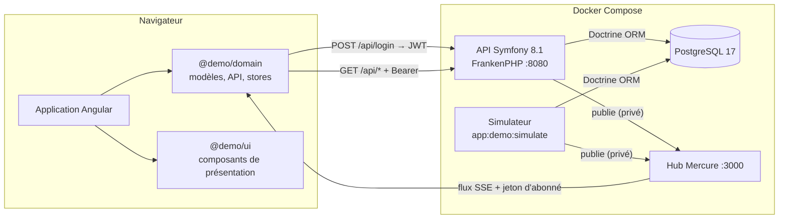

# Supervision logistique — démo Symfony & Angular

Application de démonstration : supervision d'un entrepôt fictif (équipements, missions de
transport, alarmes). Toutes les données sont inventées ; aucun code ni nom ne provient d'une
mission client.

| Partie | Stack |
| --- | --- |
| `api/` | Symfony 8.1, PHP 8.4, contrôleurs REST, Doctrine ORM, PostgreSQL 17, JWT (LexikJWTAuthenticationBundle) |
| `front/` | Angular 22 (zoneless, composants standalone), NgRx Signal Store, Angular Material (M3), D3, Vitest |
| Temps réel | Mercure (hub dédié, mises à jour privées), simulateur d'entrepôt en commande Symfony |
| Outillage | Docker Compose (FrankenPHP, PostgreSQL, Mercure), GitLab CI |

## Avancement

- [x] **Jalon 1** — squelette, authentification JWT, rôles, CI
- [x] **Jalon 2** — métier de bout en bout : équipements, missions de transport, alarmes
- [x] **Jalon 3** — temps réel (Mercure), plan D3 synchronisé avec les tableaux, graphiques d'activité

## Architecture



En développement, `ng serve` relaie `/api` vers `http://localhost:8080` et `/.well-known/mercure`
vers `http://localhost:3000` (`front/proxy.conf.json`) : pas de CORS à configurer.

### Temps réel

1. Après chaque écriture, l'API (ou le simulateur) publie la vue de l'objet modifié sur le hub,
   en mise à jour **privée**, via l'interface `App\Realtime\LiveUpdates`.
2. Le front demande un jeton d'abonné à `GET /api/realtime/token` : un jeton d'accès d'une
   heure au format du protocole Mercure 1.0 (RFC 9068, revendication `authorization_details`),
   qui n'autorise que la lecture des trois sujets de supervision.
3. `RealtimeClient` lit le flux avec `fetch` (un `EventSource` ne sait pas envoyer d'en-tête
   `Authorization`), se reconnecte seul avec un délai croissant, et redemande un jeton à chaque
   connexion.
4. `RealtimeSync` achemine chaque événement vers son store. Les composants ne connaissent que
   les stores : le plan, les tableaux et les graphiques se mettent à jour sans code spécifique.
5. À chaque (re)connexion, les stores sont rechargés : les événements émis pendant une coupure
   ne sont pas rejoués.

Le hub (Mercure 1.x) vérifie trois choses sur chaque jeton : la signature, l'émetteur (`iss`,
qui doit valoir `MERCURE_TRUSTED_ISSUERS`) et l'audience (`aud`, épinglée par
`resource_identifier`). Les jetons de publication et d'abonnement sortent de la même
configuration (`api/config/packages/mercure.yaml`).

Un hub indisponible ne fait jamais échouer une requête : la publication est journalisée et
l'écriture en base reste acquise. En test, `InMemoryLiveUpdates` remplace Mercure.

Le **simulateur** (`App\Simulation\WarehouseSimulator`) est une classe sans dépendance à la base
ni au réseau : la commande lui fournit l'état courant et enregistre ce qu'il renvoie. Il se teste
donc avec un générateur aléatoire à graine fixe.

### Front : une application, deux bibliothèques

| Projet | Rôle | Dépend de |
| --- | --- | --- |
| `front/src` (application) | pages, routage, correspondance états → couleurs | `@demo/domain`, `@demo/ui` |
| `front/projects/domain` | modèles, clients HTTP, stores, gardes, intercepteur | rien d'autre que le framework |
| `front/projects/ui` | pastille d'état, en-tête de page, indicateur, bandeau d'erreur | rien d'autre que le framework |

`@demo/domain` ne connaît aucun composant et `@demo/ui` ne connaît aucun concept métier : seule
l'application les relie (`src/app/shared/tones.ts`). Les bibliothèques sont compilées depuis
leurs sources (alias dans `tsconfig.json`), sans étape de build intermédiaire.

Chaque store métier compose les mêmes briques NgRx Signal Store :

- `withEntities` pour la collection ;
- `withRequestStatus`, une fonctionnalité maison partagée (chargement, succès, erreur) ;
- un état propre (filtres, pagination) et ses valeurs dérivées (`computed`).

`MissionStore.load` est un `rxMethod` branché sur le signal `query` : changer un filtre ou une
page relance la requête, et `switchMap` abandonne la précédente.

### Plan et tableaux synchronisés

La page Plan affiche quatre vues des mêmes données : le plan SVG, le tableau des équipements,
les missions en cours et les alarmes actives. Elles partagent `SelectionStore` : sélectionner un
équipement sur le plan ou dans le tableau filtre les deux autres. Aucune vue ne connaît les autres.

**D3 calcule, Angular dessine.** `d3-scale`, `d3-shape` et `d3-array` produisent la géométrie
dans des fonctions pures (`layoutWarehouse`, `stackedColumnsGeometry`) ; les gabarits Angular
rendent le SVG. Pas de `d3-selection` : une seule bibliothèque touche au DOM, et la géométrie se
teste sans navigateur.

### Pourquoi des stores à entités plutôt que des `Map` et des observables

| | `Map` + `BehaviorSubject` par collection | Signal Store + `withEntities` |
| --- | --- | --- |
| Mise à jour d'un élément | recréer la `Map` puis `next()` à la main | `setEntity`, immuable par construction |
| Valeurs dérivées | `combineLatest` + `map`, recalculés à chaque émission | `computed`, recalculés seulement si une dépendance change |
| Lecture dans un gabarit | pipe `async` et gestion des abonnements | lecture directe du signal |
| État de chargement | un sujet de plus par collection | `withRequestStatus`, composé une fois |
| Temps réel | chaque service fusionne son flux dans sa `Map` | `applyRemote` sur le store, un seul point d'entrée (`RealtimeSync`) |

RxJS reste utilisé là où il est le bon outil : annulation de requêtes (`switchMap`), limitation
de débit (`throttleTime`), flux d'événements.

### API : règles métier dans les entités

- Les transitions d'état vivent dans les entités (`TransportMission::cancel`,
  `Alarm::acknowledge`). Une transition interdite lève `InvalidTransition`, traduite en **409**.
- Les entrées passent par des DTO validés (`#[MapRequestPayload]`, `#[MapQueryString]`) : **422**
  pour un corps invalide, **400** pour un paramètre de liste invalide.
- Les sorties passent par des DTO de lecture (`App\Dto\*View`) : aucune entité n'est sérialisée.

| Route | Accès | Rôle |
| --- | --- | --- |
| `GET /api/health` | public | |
| `POST /api/login` | public | |
| `GET /api/me` | connecté | |
| `GET /api/users` | connecté | administrateur |
| `GET /api/equipments` | connecté | |
| `PATCH /api/equipments/{id}/status` | connecté | superviseur |
| `GET /api/missions?page=&limit=&status=&search=` | connecté | |
| `POST /api/missions` | connecté | opérateur |
| `POST /api/missions/{id}/cancel` | connecté | superviseur |
| `GET /api/alarms` | connecté | |
| `POST /api/alarms/{id}/acknowledge` | connecté | opérateur |
| `GET /api/stats/activity` | connecté | |
| `GET /api/realtime/token` | connecté | |

### Authentification et rôles

1. `POST /api/login` (`{ "email", "password" }`) renvoie `{ "token" }`.
2. Le front appelle `GET /api/me` avec le jeton et stocke le profil dans `AuthStore`.
3. L'intercepteur ajoute `Authorization: Bearer …` à chaque appel `/api/*` et ferme la session
   sur un 401.

Les rôles sont hiérarchiques : `ROLE_OPERATOR` < `ROLE_SUPERVISOR` < `ROLE_ADMIN`. L'API renvoie
les rôles **effectifs** (hiérarchie résolue), le front n'a donc aucune règle à dupliquer. L'API
reste l'autorité : les gardes Angular ne protègent que l'affichage.

### Choix techniques

- **Contrôleurs REST maison plutôt qu'API Platform** : le contrat HTTP et les DTO sont écrits à
  la main, ce qui rend chaque décision visible.
- **Hub Mercure en conteneur dédié** : même configuration en local et en déploiement. La clé
  JWT du hub présente dans `compose.yaml` est une valeur de développement, à remplacer ailleurs.
- **Jeton dans `sessionStorage`** : simple et suffisant pour une démo. En production, un cookie
  `httpOnly` est préférable.
- **Pagination côté serveur pour les missions, filtrage côté client pour les équipements** : la
  liste des missions grossit sans limite, celle des équipements tient en une requête et servira
  entière à la vue D3 du jalon 3.

## Démarrer

Prérequis : Docker, Node.js 22.22+ et `make`.

```bash
make init      # image, dépendances, clés JWT, migrations, comptes et données de démo, npm ci
make simulate  # fait vivre l'entrepôt (missions, pannes, alarmes)
make front     # http://localhost:4200
```

Comptes de démonstration (mot de passe `demo`) :

| E-mail | Rôle |
| --- | --- |
| `operateur@demo.test` | opérateur |
| `superviseur@demo.test` | superviseur |
| `admin@demo.test` | administrateur |

## Commandes

```bash
make help               # liste complète
make up / down          # démarrer / arrêter l'API et la base
make test               # PHPUnit + Vitest
make migration          # générer une migration après modification d'une entité
make seed ARGS=--reset  # recharger le jeu de données fictif
make simulate-stop      # arrêter le simulateur
```

## CI GitLab

`.gitlab-ci.yml` lance, selon les dossiers modifiés :

- **API** : lint YAML et conteneur, validation du mapping Doctrine, PHPUnit avec un service
  PostgreSQL.
- **Front** : tests Vitest (application et bibliothèques) puis build de production.
