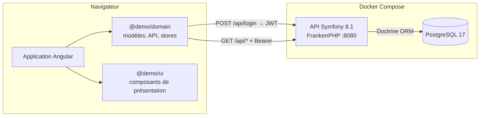

# Supervision logistique — démo Symfony & Angular

Application de démonstration : supervision d'un entrepôt fictif (équipements, missions de
transport, alarmes). Toutes les données sont inventées ; aucun code ni nom ne provient d'une
mission client.

| Partie | Stack |
| --- | --- |
| `api/` | Symfony 8.1, PHP 8.4, contrôleurs REST, Doctrine ORM, PostgreSQL 17, JWT (LexikJWTAuthenticationBundle) |
| `front/` | Angular 22 (zoneless, composants standalone), NgRx Signal Store, Angular Material (M3), Vitest |
| Outillage | Docker Compose (FrankenPHP + PostgreSQL), GitLab CI |

## Avancement

- [x] **Jalon 1** — squelette, authentification JWT, rôles, CI
- [x] **Jalon 2** — métier de bout en bout : équipements, missions de transport, alarmes
- [ ] **Jalon 3** — temps réel (Mercure) et vue D3 synchronisée avec les tableaux

## Architecture



En développement, `ng serve` relaie `/api` vers `http://localhost:8080` (`front/proxy.conf.json`) :
pas de CORS à configurer.

### Front : une application, deux bibliothèques

| Projet | Rôle | Dépend de |
| --- | --- | --- |
| `front/src` (application) | pages, routage, correspondance états → couleurs | `@demo/domain`, `@demo/ui` |
| `front/projects/domain` | modèles, clients HTTP, stores, gardes, intercepteur | rien d'autre que le framework |
| `front/projects/ui` | pastille d'état, en-tête de page, indicateur, bandeau d'erreur | rien d'autre que le framework |

`@demo/domain` ne connaît aucun composant et `@demo/ui` ne connaît aucun concept métier : seule
l'application les relie (`src/app/shared/tones.ts`). Les bibliothèques sont compilées depuis
leurs sources (alias dans `tsconfig.json`), sans étape de build intermédiaire.

Chaque store métier compose les mêmes briques NgRx Signal Store :

- `withEntities` pour la collection ;
- `withRequestStatus`, une fonctionnalité maison partagée (chargement, succès, erreur) ;
- un état propre (filtres, pagination) et ses valeurs dérivées (`computed`).

`MissionStore.load` est un `rxMethod` branché sur le signal `query` : changer un filtre ou une
page relance la requête, et `switchMap` abandonne la précédente.

### API : règles métier dans les entités

- Les transitions d'état vivent dans les entités (`TransportMission::cancel`,
  `Alarm::acknowledge`). Une transition interdite lève `InvalidTransition`, traduite en **409**.
- Les entrées passent par des DTO validés (`#[MapRequestPayload]`, `#[MapQueryString]`) : **422**
  pour un corps invalide, **400** pour un paramètre de liste invalide.
- Les sorties passent par des DTO de lecture (`App\Dto\*View`) : aucune entité n'est sérialisée.

| Route | Accès | Rôle |
| --- | --- | --- |
| `GET /api/health` | public | |
| `POST /api/login` | public | |
| `GET /api/me` | connecté | |
| `GET /api/users` | connecté | administrateur |
| `GET /api/equipments` | connecté | |
| `PATCH /api/equipments/{id}/status` | connecté | superviseur |
| `GET /api/missions?page=&limit=&status=&search=` | connecté | |
| `POST /api/missions` | connecté | opérateur |
| `POST /api/missions/{id}/cancel` | connecté | superviseur |
| `GET /api/alarms` | connecté | |
| `POST /api/alarms/{id}/acknowledge` | connecté | opérateur |

### Authentification et rôles

1. `POST /api/login` (`{ "email", "password" }`) renvoie `{ "token" }`.
2. Le front appelle `GET /api/me` avec le jeton et stocke le profil dans `AuthStore`.
3. L'intercepteur ajoute `Authorization: Bearer …` à chaque appel `/api/*` et ferme la session
   sur un 401.

Les rôles sont hiérarchiques : `ROLE_OPERATOR` < `ROLE_SUPERVISOR` < `ROLE_ADMIN`. L'API renvoie
les rôles **effectifs** (hiérarchie résolue), le front n'a donc aucune règle à dupliquer. L'API
reste l'autorité : les gardes Angular ne protègent que l'affichage.

### Choix techniques

- **Contrôleurs REST maison plutôt qu'API Platform** : le contrat HTTP et les DTO sont écrits à
  la main, ce qui rend chaque décision visible.
- **Jeton dans `sessionStorage`** : simple et suffisant pour une démo. En production, un cookie
  `httpOnly` est préférable.
- **Pagination côté serveur pour les missions, filtrage côté client pour les équipements** : la
  liste des missions grossit sans limite, celle des équipements tient en une requête et servira
  entière à la vue D3 du jalon 3.

## Démarrer

Prérequis : Docker, Node.js 22.22+ et `make`.

```bash
make init    # image, dépendances, clés JWT, migrations, comptes et données de démo, npm ci
make front   # http://localhost:4200
```

Comptes de démonstration (mot de passe `demo`) :

| E-mail | Rôle |
| --- | --- |
| `operateur@demo.test` | opérateur |
| `superviseur@demo.test` | superviseur |
| `admin@demo.test` | administrateur |

## Commandes

```bash
make help               # liste complète
make up / down          # démarrer / arrêter l'API et la base
make test               # PHPUnit + Vitest
make migration          # générer une migration après modification d'une entité
make seed ARGS=--reset  # recharger le jeu de données fictif
```

## CI GitLab

`.gitlab-ci.yml` lance, selon les dossiers modifiés :

- **API** : lint YAML et conteneur, validation du mapping Doctrine, PHPUnit avec un service
  PostgreSQL.
- **Front** : tests Vitest (application et bibliothèques) puis build de production.
