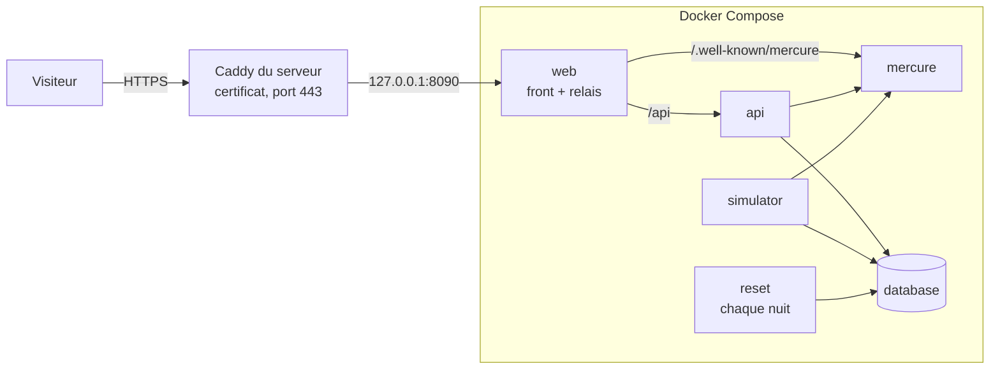

# Déploiement de la démo

La démo tourne en Docker Compose sur un serveur, derrière le Caddy déjà installé sur la machine :



Tout passe par la même origine (`https://demo-supervision.legrand-jerome.fr`) : pas de CORS, et
le front garde les mêmes adresses relatives qu'en développement.

## 1. Préparer le serveur (une seule fois)

1. **DNS** : un enregistrement `A` (et `AAAA` si le serveur a une IPv6) pour
   `demo-supervision.legrand-jerome.fr` vers le serveur.
2. **Docker** : installer Docker Engine et le plugin Compose depuis le dépôt officiel de Docker
   pour Debian, puis vérifier avec `docker compose version`.
3. **Utilisateur de déploiement** : un compte sans mot de passe, membre du groupe `docker`,
   qui ne sert qu'au job GitLab.

   ```bash
   sudo adduser --disabled-password --gecos "" deploy
   sudo usermod -aG docker deploy
   sudo install -d -o deploy -g deploy -m 750 /opt/demo-supervision
   ```

   Appartenir au groupe `docker` équivaut à être root sur la machine : la clé SSH de ce compte
   est donc aussi sensible qu'un accès root.
4. **Clé SSH** : générer une paire dédiée sur son poste (`ssh-keygen -t ed25519 -f deploy_demo`),
   ajouter la clé publique à `/home/deploy/.ssh/authorized_keys`, garder la clé privée pour GitLab.
5. **Secrets** : créer `/opt/demo-supervision/.env`, lisible par `deploy` seul (`chmod 600`).

   ```dotenv
   DEMO_HOST=demo-supervision.legrand-jerome.fr
   REGISTRY_IMAGE=registry.gitlab.com/legrandjerome/demo-supervision-logistique
   WEB_PORT=8090

   # Une valeur différente par ligne : openssl rand -hex 32
   APP_SECRET=
   POSTGRES_PASSWORD=
   JWT_PASSPHRASE=
   MERCURE_JWT_SECRET=
   ```

   `POSTGRES_PASSWORD` est placé dans une URL : `openssl rand -hex` ne produit que des
   caractères sans risque. Ce mot de passe est fixé à la création de la base ; le changer
   ensuite demande de le changer aussi dans PostgreSQL.
6. **Caddy du serveur** : ajouter le site, puis recharger (`sudo systemctl reload caddy`).

   ```caddyfile
   demo-supervision.legrand-jerome.fr {
       reverse_proxy 127.0.0.1:8090
   }
   ```

## 2. Configurer GitLab (une seule fois)

Dans *Settings > CI/CD > Variables*, toutes protégées et masquées quand c'est possible :

| Variable | Valeur |
| --- | --- |
| `DEPLOY_HOST` | nom ou adresse du serveur |
| `DEPLOY_USER` | `deploy` |
| `DEPLOY_PATH` | `/opt/demo-supervision` |
| `DEPLOY_SSH_KEY` | type **File** : la clé privée, avec une ligne vide à la fin |
| `DEPLOY_KNOWN_HOSTS` | sortie de `ssh-keyscan <serveur>`, vérifiée contre l'empreinte du serveur |

La branche `main` doit être protégée pour que les variables protégées soient transmises au job.

## 3. Déployer

1. Pousser sur `main` : le pipeline teste, puis construit et pousse les images `api` et `front`
   dans le registre du projet (étape *release*).
2. Lancer à la main le job `deploy:production`. Il copie `compose.prod.yaml` sur le serveur,
   récupère les images du commit et relance les services.

Au démarrage, le service `init` crée les clés JWT, applique les migrations et charge les comptes
et les données de démo. Il est rejoué à chaque déploiement et ne refait jamais ce qui est déjà fait.

## 4. Exploiter

```bash
cd /opt/demo-supervision
docker compose ps                      # état des services
docker compose logs -f api simulator   # journaux
docker compose run --rm init php bin/console app:demo:seed --reset   # remise à zéro immédiate
```

- **Remise à zéro** : le service `reset` recharge les données chaque nuit à 4 h UTC.
- **Retour arrière** : relancer le job `deploy:production` d'un pipeline précédent.
- **Sauvegardes** : aucune, volontairement. Toutes les données sont fictives et rechargeables.

## Points d'attention

- Les images du registre sont privées tant que le dépôt l'est. Le serveur ne garde pas
  d'identifiants : après un redémarrage, les conteneurs repartent sur les images déjà présentes.
- Les comptes de démonstration sont publics : ne jamais y saisir de données réelles.
- Le front envoie `X-Robots-Tag: noindex` : la démo n'est pas indexée par les moteurs de recherche.
